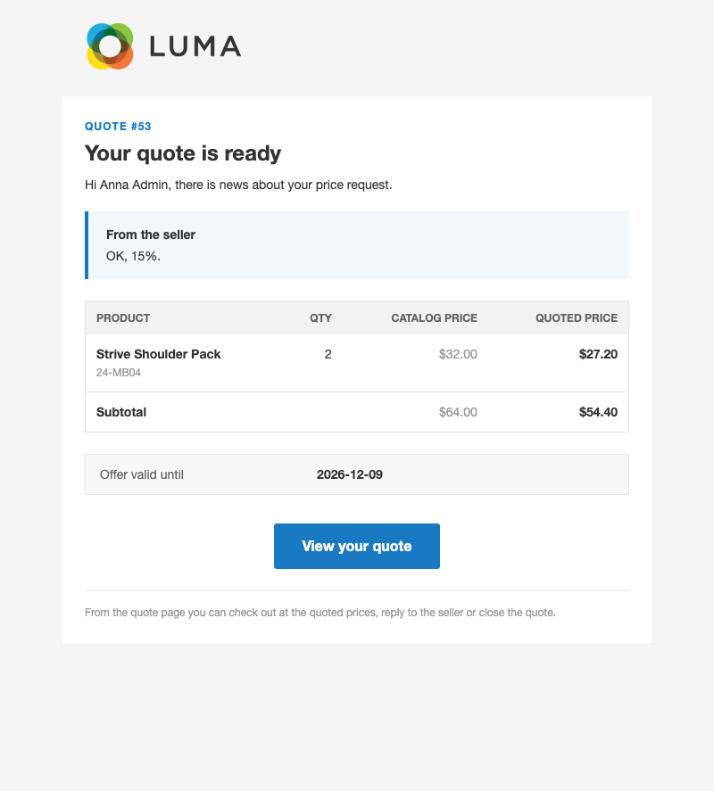
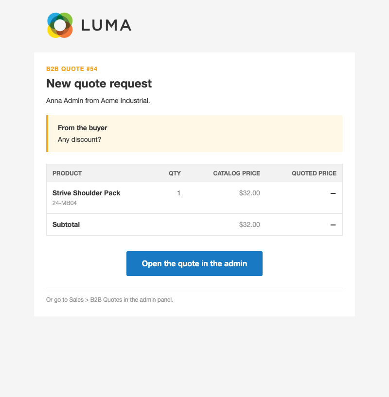

# B2B Quotes for Magento 2

Let business buyers ask for a better price and check out at the price you agree on.

Negotiable quotes are an Adobe Commerce B2B feature (`Magento_NegotiableQuote`); Magento Open Source has none. This
module adds them for company accounts created with Tonyapps B2B: a buyer sends their cart as a price request, your
sales team answers with a price per line, and the buyer checks out at those prices using the normal checkout and any
payment method.

## Features

- **Request a quote from the cart** — company buyers send their cart with a comment in one step. Their cart stays
  as it was.
- **Price per line** — on the admin quote page you see each line's catalog price and enter a negotiated unit price,
  or discount every line by a percentage at once. Discount % and row totals update as you type.
- **A real conversation** — buyers and sellers exchange comments on the quote. The buyer can send an offer back with
  a comment; you can reply without changing the offer. Every step is kept in the quote history.
- **Offer validity** — each offer has an expiry date (pre-filled from a default number of days). Expired offers can
  no longer be used, and you can renew them with a new offer.
- **Checkout at the agreed price** — the buyer clicks **Checkout with This Quote**; the cart is filled with the quote
  lines at the negotiated prices. Tax, shipping and every payment method work as usual.
- **Protected prices** — negotiated prices only apply to the exact lines and quantities that were quoted. Coupons and
  cart price rules don't stack on top of them. The buyer can leave the quote at any time to return to regular prices.
- **Company visibility** — buyers see their own quotes; the company administrator sees every quote in the company.
  Who may request quotes is a company role permission.
- **Email notifications** — your sales inbox is notified of new requests and buyer replies; buyers get the offer or
  decline, with a copy to their company administrator. Emails list the quoted lines, both subtotals, the latest
  comment and the offer's validity. The seller email links straight to the quote in the admin.
- **Order link** — once ordered, the quote shows the order number on both the storefront and admin pages, and it
  cannot be used again.

## How it works

1. A company buyer with the **Request quotes** permission opens the cart and uses **Request a Quote**, adding a
   comment.
2. Your sales team opens **Sales › B2B Quotes**, sets prices and an expiry date, and clicks **Send Offer** (or
   **Send Comment Only**, or **Decline**).
3. The buyer sees the offer under **My Account › My Quotes**: lines, prices, total, comments and expiry. They can
   reply and send it back, close it, or click **Checkout with This Quote**.
4. The buyer completes the normal checkout. The quote is marked as ordered and linked to the order.

## Screenshots

Emails as sent (Luma theme, 2026-11-09). Source images are in `docs/emails/`.

**Offer ready (to the buyer)**



**New quote request (to the seller)**



## Good to know

- Only company accounts (Tonyapps B2B) can request quotes; guests and regular customers cannot.
- Simple, virtual and configurable products only. A cart with bundle, grouped, gift card or downloadable products
  cannot be sent, and the cart page says why.
- The seller sets prices but cannot change quantities, add or remove lines, or create a quote on the buyer's behalf.
- Shipping is calculated at checkout and is not negotiated. No whole-quote percentage discount field, quote PDFs,
  file attachments or quote templates.
- Only the buyer who requested the quote can check out with it.
- Multi-address checkout is not available for a quoted cart.
- The admin quote list is a simple paged list without filters or sorting.
- If you use Tonyapps B2B Order Approval, a quoted cart above the approval threshold still needs approval. Tonyapps
  Free Gift rules still apply to a quoted cart.

## Requirements

- Magento Open Source 2.4 (developed on 2.4.8-p4)
- PHP 8.3 or 8.4
- `tonyapps/module-b2b`

## Installation

```bash
composer require tonyapps/module-b2b-quotes
bin/magento setup:upgrade
```

Then enable the module and give company roles the **Request quotes** permission (company administrators always have
it).

## Configuration

- **Stores › Configuration › Tonyapps › B2B Quotes › General** — enable per website (off by default), default offer
  validity in days, and the email address that receives new requests and buyer replies.
- **Stores › Configuration › Tonyapps › B2B Quotes › Email Templates** — seller and buyer notice templates.
- **Sales › B2B Quotes** — the quote list and quote pages.
- **System › Permissions › User Roles** — the *B2B Quotes* resource controls which admin users can handle quotes.

### Redesigning the emails

Emails can be redesigned with the [Email Designer](https://github.com/tonyappsorg/magento2-email-designer): open
**Marketing › Communications › Email Designer**, start a design for the email and save it, then pick the saved
design in the email template setting above. The built-in template is used until a design is picked. A new design
starts from a ready-made copy of the quote email, with the quote lines, comments and offer validity as drag-and-drop
blocks.

## For developers

Architecture, decisions, data model and tests are in [AGENTS.md](AGENTS.md).
